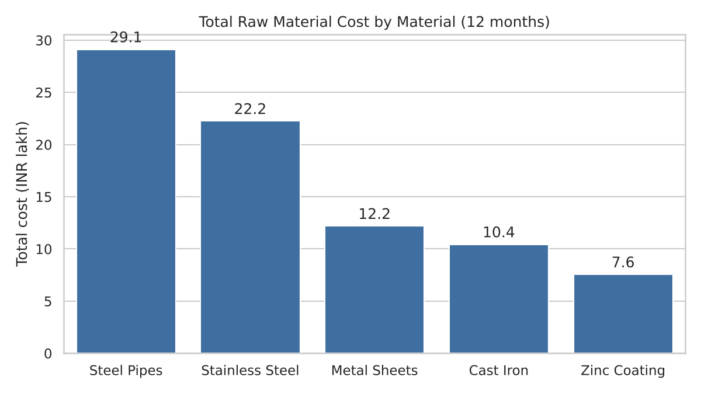
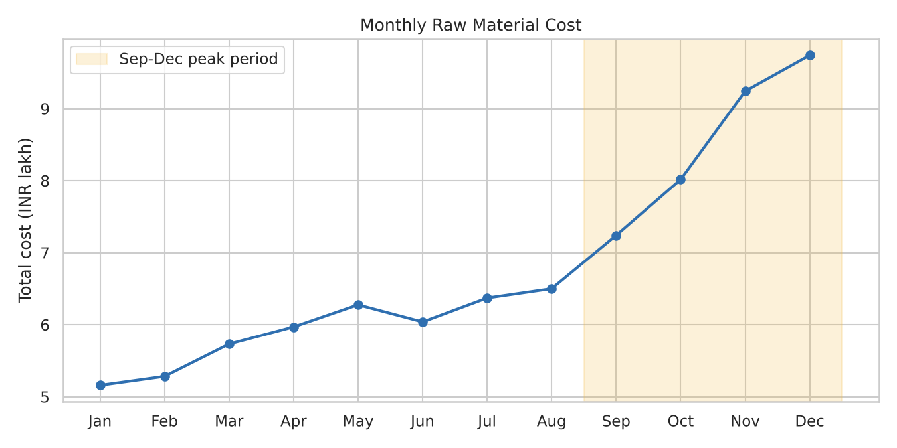
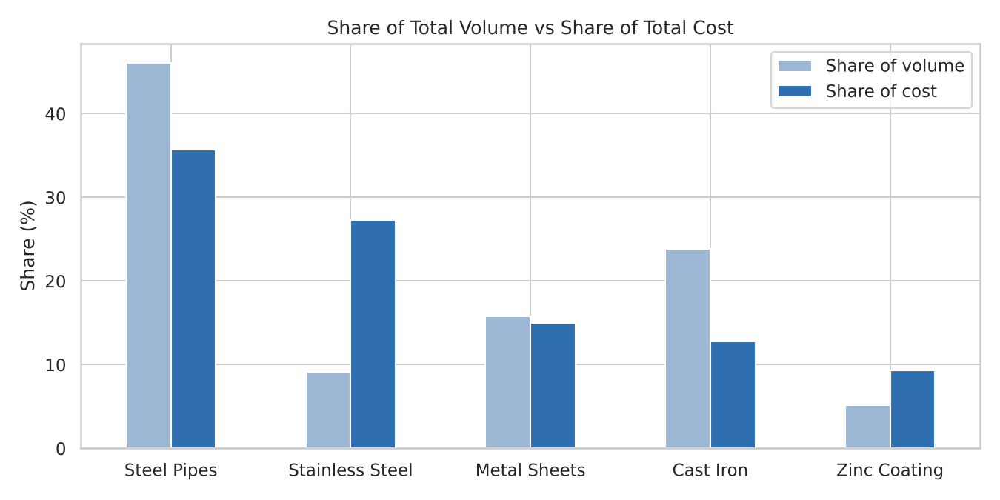

# Raw Material Usage Analysis: Swati Industries

An end-to-end data analysis of raw material consumption and cost for a metal-products manufacturer (Swati Industries, Ludhiana, Punjab). The project identifies the main cost drivers, the seasonal spending pattern, and where procurement could be optimized.

> **About the data:** The dataset is **simulated**. It was created to mirror the structure of raw-material records (5 materials x 12 months, 60 rows) and contains no real company figures. The goal is to demonstrate the analysis workflow.

**Author:** Roopali | **Tools:** Python (pandas, matplotlib, seaborn), Excel (formulas, PivotTables, charts)

## Business questions
1. Which raw materials drive the most cost?
2. How does raw material spending change across the year?
3. Which materials are expensive relative to how much of them is used?

## Key findings
| Finding | Detail |
|---|---|
| **Two materials drive 63% of spend** | Steel Pipes (36%, about ₹29.1 lakh) and Stainless Steel (27%, about ₹22.2 lakh) |
| **Costs climb sharply late in the year** | December is 89% above January; average monthly spend in Sep-Dec is about 45% above Jan-Aug |
| **Some materials cost more than their volume suggests** | Stainless Steel is 9% of volume but 27% of cost; Zinc Coating is 5% of volume but 9% of cost |





## Recommendations
- **Negotiate bulk or contract pricing** for Steel Pipes and Stainless Steel, the largest share of spend.
- **Forecast demand and buy ahead of the Sep-Dec peak** to smooth cash flow and reduce exposure to price rises.
- **Review Stainless Steel and Zinc Coating usage** for alternatives or more efficient application.

## Approach
1. **Data preparation:** built the dataset, calculated `total_cost_inr` (quantity x cost per kg).
2. **Data quality checks:** no missing values, duplicates, or negative quantities; totals reconcile.
3. **Aggregation:** Excel PivotTables / `SUMIFS` and pandas `groupby` by material and month, with results cross-checked between the two.
4. **Visualization:** bar and line charts in Excel and Python.
5. **Recommendations:** summarized in a written report (`docs/SOP_document.docx`).

## Dataset columns
| Column | Description |
|---|---|
| `product_id` | Product code (P-001 to P-005) |
| `material_name` | Steel Pipes, Cast Iron, Stainless Steel, Metal Sheets, Zinc Coating |
| `quantity_used_kg` | Monthly material used (kg) |
| `cost_per_kg_inr` | Unit cost (INR per kg) |
| `production_month` | January to December |
| `total_cost_inr` | `quantity_used_kg` x `cost_per_kg_inr` |

## Repository structure
```
data/        swati_dataset.csv, swati_dataset.xlsx (with formulas and Excel charts)
notebooks/   swati_industries_analysis.ipynb
charts/      PNG exports of the charts
docs/        SOP_document.docx (written report)
```

## How to run
```bash
pip install -r requirements.txt
jupyter notebook notebooks/swati_industries_analysis.ipynb
```

## Limitations
The data is simulated, covers one year, and has no supplier or product-level detail, so the findings are illustrative. With real data, the next steps would be validating the seasonal pattern across multiple years and testing price-per-kg trends.
